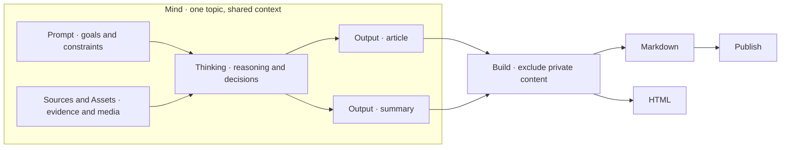
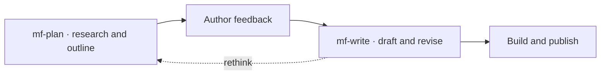

# mind-forge

English · [简体中文](README.zh-CN.md)

[](https://github.com/alswl/mind-forge/actions/workflows/ci.yml)
[](https://github.com/alswl/mind-forge/releases)

**A local-first, AI-native CLI for card-based writing and personal knowledge.**

Turn evidence and reasoning into articles, reports, and summaries. `mf` keeps
intent, research, and editable outputs together in a **Mind**, using ordinary
Markdown and YAML files you can edit, version, and reuse.



A Mind can begin with research alone and grow into several deliverables. Each
Output is editable as one file or ordered Markdown blocks; Markdown and HTML
builds are derived artifacts. Private content stays in the authored files for direct reading and editing.

## Why mind-forge

| Principle | What it means |
| --- | --- |
| **Diffusion** | Reuse evidence and authored knowledge across outputs; retrieve it with provenance. |
| **Document as Code** | Review Markdown and YAML in Git, lint structure, and build deterministically. |
| **AI Native CLI** | Compose commands with structured JSON, predictable exit codes, and dry-run previews. |
| **Local first** | Keep authored content and source registrations in ordinary repository files. |

## Features

| Capability | What you can do |
| --- | --- |
| **Card-based writing** | Compose an Output from ordered Markdown blocks, or keep it in one file. Develop an article and a summary from the same Mind. |
| **Private authoring, public delivery** | Keep private callouts and blocks alongside drafts; builds remove them while authored files retain them. |
| **Build and publish** | Generate Markdown or HTML, render Mermaid in HTML, customize page templates, and run asset pipelines. Publish built Markdown locally or prepare a Yuque publishing prompt. |
| **Safe organization** | Preview layout conversions, moves, and renames; maintain supported references and recover interrupted changes. [Storage constraints](docs/guide/manage-content.md) apply. |
| **Consistent terminology** | Maintain a shared glossary, lint usage, and apply corrections while respecting quoted and verbatim text by default. |
| **Agent-assisted writing** | Research and outline with `mf-plan`, then draft and revise with `mf-write`; keep author feedback beside the affected text. |

## Install

```bash
curl -fsSL https://raw.githubusercontent.com/alswl/mind-forge/master/scripts/install.sh | sh
export PATH="${MF_INSTALL_DIR:-${XDG_BIN_HOME:-$HOME/.local/bin}}:$PATH"
```

Prebuilt releases support macOS and Linux on x86_64 and ARM64; the installer
verifies SHA-256 checksums. See [installation](docs/guide/install.md) for version
selection and building from source with Rust 1.91+.

## Quick start

Create a Mind with two editable Outputs, then build an article:

```bash
mkdir my-repo && cd my-repo
mf init
mf project new research --layout category
mf mind new brief -p research
mf output new brief design -p research
mf output new brief summary --file -p research
```

Your editable files stay separate from generated artifacts:

```text
projects/research/
├── outputs/brief/
│   ├── design/01-opening.md   # editable blocks
│   └── summary.md            # editable single file
└── build/brief/              # generated by mf build
    ├── design.md
    └── design.html
```

Edit `design/01-opening.md`, add more numbered blocks as needed, then build:

```bash
mf build projects/research::brief::design
mf build projects/research::brief::design --format html
```

The results are `projects/research/build/brief/design.md` and `design.html`.
Use `--layout bundle` to keep each Mind's files together instead of grouping
by role. See [Minds and Outputs](docs/guide/minds-and-outputs.md) for the full flow.

Builds exclude private content. Publishing is an explicit step that uses an
existing Markdown build. See [build and publish](docs/guide/build-and-publish.md)
for private markers and target configuration.

## Write with an agent



Both skills work on the same Mind and selected Output. `mf-cli` provides the
command reference, including Source management. Install them from [skills/](skills/README.md).

## Documentation

| Task | Guide |
| --- | --- |
| Create and organize content | [Minds and Outputs](docs/guide/minds-and-outputs.md) · [Move, rename, and recover](docs/guide/manage-content.md) |
| Find and reuse knowledge | [Sources](docs/guide/sources.md) · [Terms](docs/guide/terms.md) |
| Produce deliverables | [Build and publish](docs/guide/build-and-publish.md) · [HTML and diagrams](docs/guide/build-html.md) |
| Look up exact behavior | [CLI reference](docs/manual/cli.md) · [Content layouts](docs/manual/content-layout.md) |
| Develop mind-forge | [Build and test](docs/dev/build-workflow.md) |

[All documentation](docs/README.md) · `mf <command> --help`
