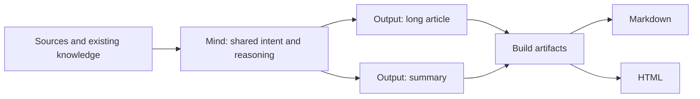
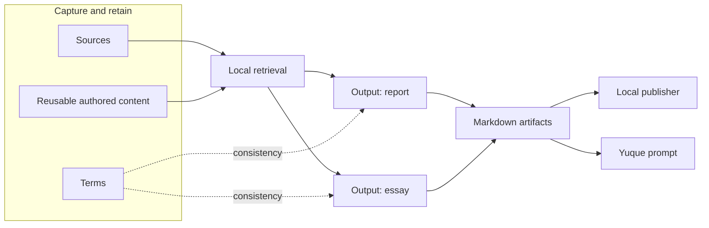
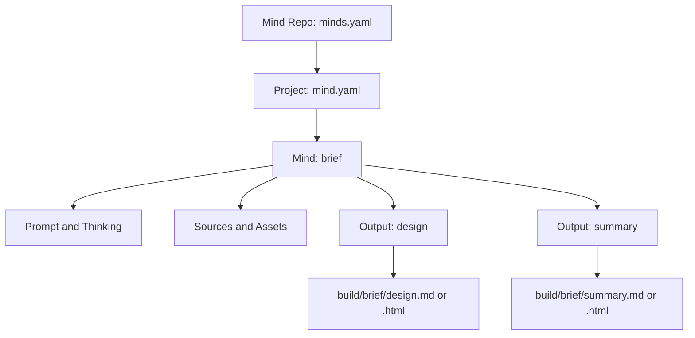
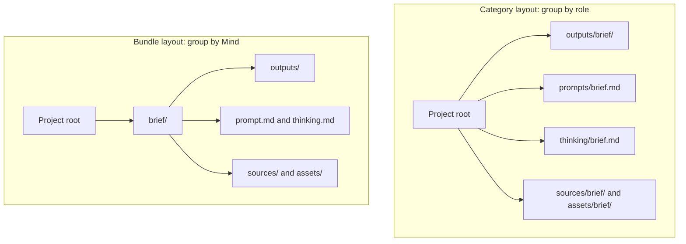
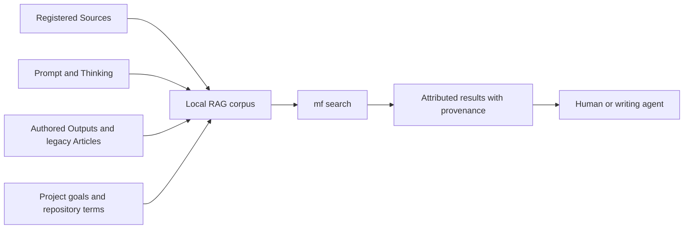
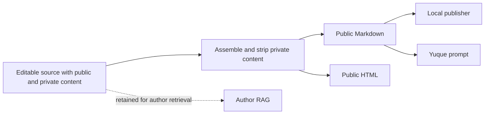
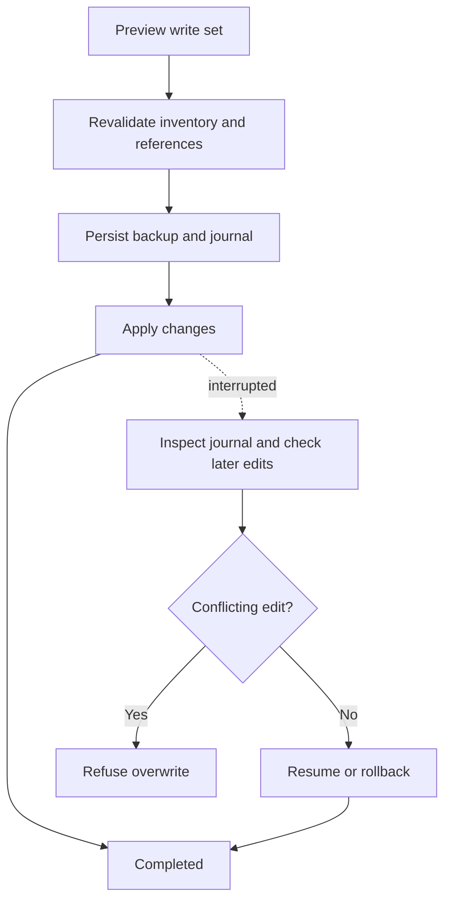
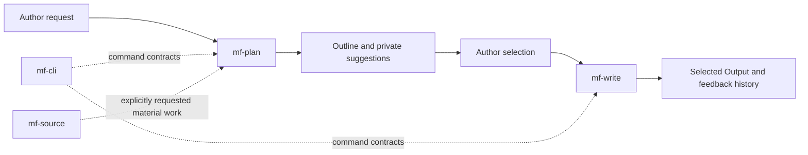

# mind-forge

[](https://github.com/alswl/mind-forge/actions/workflows/ci.yml)
[](https://github.com/alswl/mind-forge/releases)


**A local-first, AI-native CLI for card-based writing and personal knowledge.**

`mf` manages minds: named collections of intent, reasoning, evidence, and editable
outputs. A mind can have zero, one, or several outputs. Each output can be a single
Markdown file or ordered blocks. Build artifacts stay separate from authored
sources, and private content is excluded from builds and publication.



A Mind can exist before any deliverable is ready. The same editable Output can
produce Markdown and HTML without becoming two different content objects.

## Philosophy

Four ideas shape the product.

### Diffusion

Knowledge should move instead of being copied. A Source, term, or reusable
Block can contribute to several outputs; an output can then flow to several
publishers. The repository preserves those connections — including the RAG path
that finds existing knowledge and its provenance before new prose is written.



### Document as Code

Writing deserves the same engineering discipline as software:

- Markdown and YAML are the durable interfaces;
- schemas and lint rules make structure explicit;
- deterministic builds turn sources into outputs;
- reconciliation never reorders or drops entries it did not change;
- Git records the history of both content and decisions.

If a code change can be reviewed as a diff, a chapter should be reviewable the
same way. Derived indexes and build products never replace authored files.

### AI Native CLI

An Agent should not need to scrape colorful terminal prose or guess whether a
command succeeded. `mf` exposes stable single-level JSON envelopes, predictable
exit codes, canonical identities, dry-run support, and explicit confirmation
boundaries — a command surface deterministic enough to compose, inspect, retry
and audit.

### Local first

The repository remains useful without a cloud service. Authored content stays
in ordinary files, secrets stay outside committed configuration, and the
embedded RAG corpus rebuilds locally. External services extend the workflow;
they do not own it.

## Install

> [!NOTE]
> Prebuilt binaries for tagged versions are attached to
> [GitHub Releases](https://github.com/alswl/mind-forge/releases). Building from
> source requires Rust 1.91+.

```bash
curl -fsSL https://raw.githubusercontent.com/alswl/mind-forge/master/scripts/install.sh | sh
export PATH="${MF_INSTALL_DIR:-${XDG_BIN_HOME:-$HOME/.local/bin}}:$PATH"
```

The installer downloads the latest stable tagged release for macOS or Linux on
x86_64 or ARM64 and verifies its SHA-256 checksum. Set `MF_VERSION=vX.Y.Z` to
install a specific tag, or `MF_INSTALL_DIR` to choose the install directory.
To build from a checkout instead, run `scripts/install.sh`; it keeps its build
directory between runs, so later installs rebuild only `mf` and skip the ~490
dependency crates.

Shell completion: `mf completion <shell>`.

## Quick start

Create an explicit category layout, then add two deliverables to one Mind:

```bash
mkdir my-repo && cd my-repo
mf init
mf project new research --layout category
mf mind new brief -p research
mf output new brief design -p research
mf output new brief summary --file -p research
mf output list projects/research::brief
mf build projects/research::brief::design
mf build projects/research::brief::design --format html
```

The default Output shape is a directory of ordered Markdown blocks. `--file`
creates a single Markdown source. The products above are
`build/brief/design.md` and `build/brief/design.html` under the project root.
Edit the Output sources to develop the article. Build products remain derived.

Use `--layout bundle` to group each Mind's content in its own directory.
Creation rejects name, case, and file/directory collisions instead of overwriting.

Use identities returned by `mf mind list` and `mf output list` when selecting
content. Full identities select their project; a conflicting `--project` fails.
A Mind with one Output can select it implicitly. Several Outputs require an
explicit selection or a valid `default_output`. A Mind with zero Outputs cannot build.

See [minds and outputs](docs/guide/minds-and-outputs.md) for the task sequence and
[content layouts](docs/manual/content-layout.md) for exact paths and fields.
Projects without `content_layout` retain their
[legacy Article workflow](docs/guide/legacy-articles.md), including the
[offline walkthrough](quickstart.md). Existing Articles are not automatically
migrated or assigned to Minds.

## The Mind Repo model

A Mind Repo contains projects. Each project owns Minds, and each Mind holds shared
research and zero or more editable Outputs:

| Object | Responsibility |
|---|---|
| **Mind** | Groups the intent, reasoning, materials, and deliverables of one topic. |
| **Prompt** | Objective, audience, constraints, criteria, and durable decisions. |
| **Thinking** | Reasoning, comparisons, assumptions, feedback, and follow-ups. |
| **Source** | Evidence and provenance: what the work can rely on. |
| **Asset** | Supporting media and other tracked files. |
| **Output** | An editable synthesis or deliverable, as a single file or ordered blocks. |
| **Build artifact** | Public Markdown or HTML derived from an Output. |



Prompt and Thinking are authored Markdown. Mind registration and source files
remain authoritative. The Output and Additional sections of `mind-index.yaml` are
rebuildable projections. List, show, and build can discover Outputs before indexing.

### Two physical layouts

Choose how files are organized without changing the Mind/Output model:



For example, a category project can contain:

```text
my-repo/
├── minds.yaml
├── projects/
│   └── research/
│       ├── mind.yaml
│       ├── mind-index.yaml
│       ├── outputs/
│       │   └── brief/
│       │       ├── design/01-opening.md
│       │       └── summary.md
│       ├── prompts/brief.md
│       ├── thinking/brief.md
│       ├── sources/brief/
│       ├── assets/brief/
│       └── build/brief/
│           ├── design.md
│           └── design.html
└── .mind-forge/cache/source/advanced/
```

Optional roles are created when needed. The tree illustrates their locations,
not a requirement to create every role. `minds.yaml` describes the repository;
`mind.yaml` describes the project; `mind-index.yaml` contains index projections
and compatibility records. See the [glossary](docs/manual/glossary.md) for terms.

## Workflow


The diagram describes the writing process. Commands remain explicit: search does
not write prose, building does not publish, and publishing does not build.

| Step | Where / command |
|---|---|
| Set intent | The selected Mind's Prompt records objective and constraints. |
| Capture evidence | `mf source new` records material with provenance. |
| Reason | The Mind's Thinking records comparisons, decisions, and open questions. |
| Sync / search | `mf source sync --offline`, then `mf search <QUERY>`. |
| Write | Edit the selected Output, directly or with the writing skills. |
| Build | `mf build <output-identity>`. |
| Publish | `mf publish run <output-identity>`. |

### Source RAG




#### Canonical search

```bash
mf source sync --offline                       # build or refresh the corpus
mf search "topic or claim" --output json --limit 20
mf search "topic" --project notes --source reference
mf source status --output json
```

`mf search` is the canonical global retrieval command. It has no `--mode`
flag and searches registered Sources, authored Outputs and Articles, Prompts, Thinking, project
goals, and repository terms.

Every hit carries a structured `context` on each `registrations[]` entry —
repository and owning project, content kind, article status, internal
`relations`, and `imported_by` provenance for Source hits. Use it to attribute
and cite a result instead of re-deriving it. Search is read-only.

`mf source search --mode ...` is retained only for old scripts.

#### Source dual-write

When RAG is active, `mf source new` performs a deliberate dual write:

1. Lance receives the authoritative Source registration first.
2. The project's `mind-index.yaml` receives a compatibility projection.

A projection warning does not mean the primary Source was lost. Run
`mf source sync` to reconcile it. Repositories without RAG remain legacy-only
until their first successful sync. Pass `--no-index` to register a Source
without indexing it.

Sync is local-first and non-destructive. It reads saved local Source files and
discovers authored legacy Article prose, mind Outputs, Prompts, Thinking,
project goals (`mind.yaml`), and repository terms by default. Legacy projects
store Article sources in `docs/` and build artifacts in `outputs/`. Explicit
category/bundle layouts use [their fixed source paths](docs/manual/content-layout.md)
and put build artifacts under `build/`. Build artifacts and Additional resources
do not enter the authored Output corpus.

Unchanged content is synchronized idempotently. The sync
report includes per-kind `coverage` and item-by-item `skipped_items` (each with
a `reason`) so nothing is silently dropped.

`mf source new` accepts `--article <PATH>` to record the originating article as
authoritative import provenance on the Source binding.

> [!WARNING]
> `mf source rename <old> <new>` treats `<new>` as a path
> (cwd-relative or absolute). To rename in place, give the full path including
> directory and extension, e.g. `mf source rename srcfile sources/pdf/renamed.pdf`.

#### Maintenance and bundles

```bash
mf source admin rebuild --offline
mf source admin clear --dry-run
mf source admin recover --snapshot <ID> --dry-run
mf source export --output-dir ./backup.mfbundle
mf source import ./backup.mfbundle --dry-run
mf source trace
```

The RAG storage schema is `v3`, and compatibility is read from the
`registrations` table's on-disk structure rather than a recorded version, so it
cannot go stale. A repository predating the current schema refuses
`search`/`sync` with a diagnostic; run `mf source sync --rebuild` once. No
migration shim is provided.

Lance is authoritative for Sources and `mind-index.yaml`'s `sources:` section is
a lossless projection of it; terms remain authoritative in `mind-index.yaml`.
Reconcile operations import missing registrations and never delete them
implicitly — the corpus on disk is the source of truth for recovery.

Optional semantic embeddings use an OpenAI-compatible `/v1/embeddings`
provider. Credentials belong in environment variables or the gitignored
`minds-secrets.yaml`, never in committed configuration.

### Legacy Article blocks

Projects without an explicit category/bundle layout use the Article commands:

```bash
mf article new "Design Review" --template arch --project notes
mf article block new design-review risks --project notes
mf article block move design-review risks --after context --project notes
mf article block renumber design-review --project notes
```

| Template | Use |
|---|---|
| `blank` | Default; a single opening block |
| `arch` | Architecture decision: context, decision, consequence, alternatives |
| `prd` | Product requirements |
| `blog` | Blog post |
| `<path>` | Any template file under the project root |

New articles are directories of numbered blocks (`01-opening.md`, ...). Pass
`--file` to create a single-file article instead; `mf article convert
--to-single-file|--to-directory` switches between the two forms.

### Build

Build the selected editable Output with its full identity. Markdown is the default;
`--format html` uses the same source and public-content rules.



`mf build` merges blocks in filename order and rewrites relative links so they
resolve from the output directory. It can also run an asset pipeline declared
in `mind.yaml`:

```yaml
build:
  strip_first_h1: true
  pipeline:
    - name: d2-to-svg
      input_extension: d2
      output_extension: svg
      command: "d2 {input} {output}"
    - name: svg-to-png
      input_extension: svg
      output_extension: png
      command: "rsvg-convert {input} --output {output}"
```

Asset pipeline stages rebuild only missing or stale outputs. Rebuilding a stage
also rebuilds the stages after it. If an optional tool is missing or fails, `mf`
prints a warning and leaves existing outputs in place. `mf build <output-identity>
--dry-run` prints the plan without running anything.

#### Private content

Private content stays in the authored files and is still indexed for your own
RAG retrieval, but it is stripped once during assembly, so generated build products exclude it. Publication uses the built Markdown artifact.

| Marker | Effect |
|---|---|
| `> [!mf-private]` / `> [!mind-forge-private]` callout | The callout is removed (markers inside fenced code are kept as examples) |
| Block front matter `mind-forge-visibility: private` | The whole block is skipped |

> [!IMPORTANT]
> The build fails rather than emit a titleless artifact if the first/title block
> is private, or if `mind-forge-visibility` is anything other than `public` or
> `private`. `mf article lint` reports both cases in legacy projects.

### Publish

Publication requires an existing Markdown build. It does not build automatically.
Local targets preserve the Mind/Output hierarchy, so two Minds can use the same
Output name. A destination inside a category/bundle project must stay under `build/`.
HTML rendering is separate from the Markdown publication contract.

```yaml
# projects/research/mind.yaml
publish:
  default_target: local
  targets:
    - name: local
      type: local
      path: ../../published
```

```bash
mf publish run projects/research::brief::design --dry-run
mf publish run projects/research::brief::design
```

| Target type | Behavior |
|---|---|
| `local` | Copies the built article to `path` (relative paths resolve from the project directory; honors `config.prefix`) |
| `yuque-prompt` | Writes a persistent prompt file for an agent to publish to Yuque |

Without `--target`, `mf` uses `publish.default_target`. File-based publishers in
`.mind-forge/publisher/<name>.yaml` are discovered as well. Front matter is kept
by default; set `publish.strip_front_matter: true` or pass
`--strip-front-matter` for one run (`--keep-front-matter` overrides the
project setting).

For legacy Articles, `mf render <article> --template report` writes a render
prompt instead of a file. It is meant to be handed to an agent.

### Organize and recover content

`mf lifecycle` converts explicit layouts and renames, moves, or removes Minds and
Outputs. It maintains supported references and registration paths. Preview first:

```sh
mf lifecycle convert --to bundle -p research --dry-run
mf lifecycle mind-rename projects/research::brief release --dry-run
mf mind index --check -p research
```



Recovery refuses to overwrite conflicting later edits. Lifecycle operations reject
unknown ownership, unsafe links, cross-device moves, and unsupported storage.
Lance-backed Source/RAG remains usable, but lifecycle mutation refuses Lance
authority. See [manage content](docs/guide/manage-content.md) for recovery states
and filesystem constraints.

Additional resources such as review files or evaluation directories can be
discovered and managed with `mf additional`. They do not automatically become
build, publish, retrieval, or execution inputs. See
[Additional resources](docs/guide/additional-resources.md).

### Terms

```bash
mf term new "Release Note" --project notes
mf term lint --project notes
mf term fix --project notes --ad-hoc 'listnode=>Release Note' --yes
```

By default, lint and fix leave blockquotes, inline code and `「verbatim spans」`
alone. Pass `--include-quotes` when quoted text should be corrected too. See
the [term correction reference](docs/manual/term-corrections.md).

## Agent skills



Planning and writing use the same selected Output identity and real source paths.
Feedback remains beside the affected text. Resolving a thread requires completed,
verified work; partial and deferred work stays distinguishable from resolved work.

[`skills/`](skills/) contains Claude Code skills for the `mf` workflow:

| Skill | Role |
|---|---|
| `mf-cli` | Full command, flag and JSON-envelope reference |
| `mf-plan` | Research, evidence comparison, outline-first planning and feedback routing |
| `mf-write` | Drafting, revision, assembly, build and explicit publishing |
| `mf-source` | Safe source registration, RAG sync and search (manual invocation) |

To install one, copy or symlink its directory into your agent's skills folder
(for example `~/.claude/skills/`). [skills/README.md](skills/README.md) explains
how the skills hand work to each other.

## Command groups

| Group | Subcommands |
|---|---|
| `mf init` | Initialize a directory as a Mind Repo |
| `mf project` | `new` `list` `show` `update` `rename` `remove` `archive` `lint` `index` `import` |
| `mf mind` / `mf output` | Create, list, show, and index Minds and Outputs. |
| `mf lifecycle` | Convert layouts, rename/move/remove content, and recover interrupted changes. |
| `mf additional` | Discover, show, rename, and remove a Mind's Additional resources. |
| `mf article` | `new` `list` `show` `update` `rename` `move` `remove` `lint` `index` `convert` `block` |
| `mf article block` | `new` `move` `renumber` `rename` `rm` |
| `mf prompt` / `mf thinking` | `list` `show` |
| `mf source` | `new` `list` `show` `update` `rename` `move` `remove` `index` `clean` `sync` `status` `export` `import` `trace` `search` |
| `mf source admin` | `rebuild` `clear` `recover` |
| `mf search` | Repository-wide RAG search |
| `mf asset` | `new` `list` `show` `update` `rename` `move` `remove` `index` `clean` |
| `mf term` | `new` `list` `show` `update` `rename` `move` `remove` `lint` `fix` `correction` |
| `mf term correction` | `add` `list` `show` `update` `remove` |
| `mf build` | Build a selected Output or legacy Article as Markdown or HTML. |
| `mf publish` | `run` `update` `target list` `target show` |
| `mf render` | Render prompts; `template list` `template show` |
| `mf config` | `schema` `show` `generate` `default` `terminal` |
| `mf completion` / `mf version` | Shell completion, version info |

Use `mf <command> --help` for current flags, or the generated
[CLI manual](docs/manual/cli.md) for the full reference. After changing CLI
definitions, regenerate it with `scripts/generate-manual.sh`.

## Output and safety

JSON commands use `{ "status", "command", "data" }` envelopes. Exit codes are:

| Code | Meaning |
|---|---|
| `0` | Success |
| `1` | Runtime/storage failure |
| `2` | Invalid input or rejected operation |

Global flags: `--root`, `--config`, `-p`/`--project`, `-o`/`--output text|json`,
`--json`, `-q`, `-v`, `--no-color`.

Read-only retrieval does not modify authored files. Use supported `-n`/`--dry-run`
options to preview changes before writing. Check each command for confirmation
and force options; `-f`/`--force` is not a universal override. `-q` silences successful output while preserving
diagnostics and exit codes, for byte-silent automation.

## Documentation

- [User guides](docs/guide/README.md): create, organize, search, build, and publish.
- [Reference manual](docs/manual/README.md): commands, layouts, identities, fields, and terms.
- [Developer documentation](docs/dev/README.md): build, test, and implementation details.

## Development

```bash
cargo ck                 # fast type check while editing
cargo t1 cli_article     # run one test target
cargo test               # full suite, pre-push gate
cargo fmt --check && cargo clippy -- -D warnings
```

`mf` is one ~50k-line crate, so the full suite is the slow path.
[build workflow](docs/dev/build-workflow.md) says when each tier is worth
running. Commit messages follow Conventional Commits.
