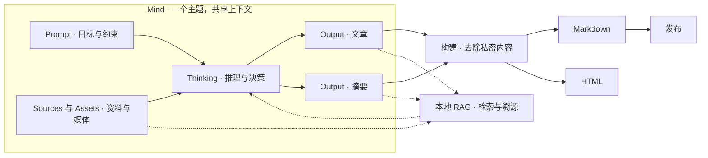

# mind-forge

[English](README.md) · 简体中文

[](https://github.com/alswl/mind-forge/actions/workflows/ci.yml)
[](https://github.com/alswl/mind-forge/releases)

**本地优先、面向 AI Agent 的卡片式写作与个人知识管理 CLI。**

把资料和思考变成文章、报告与摘要。`mf` 用一个 **Mind** 组织同一主题的目标、研究过程和可编辑成果，内容保存在普通的 Markdown 与 YAML 文件中，方便编辑、版本管理和复用。



一个 Mind 可以从研究开始，逐步形成多个交付物。每个 Output 都是可编辑的源稿，可以使用单个文件或有序的 Markdown 块；构建得到的 Markdown 和 HTML 是派生产物。私密内容保留在源稿中，仍可供作者自己的检索使用。

## 核心理念

| 理念 | 含义 |
| --- | --- |
| **知识流动（Diffusion）** | 让资料和已有创作在多个成果之间复用，检索时保留来源。 |
| **文档即代码（Document as Code）** | 用 Git 评审 Markdown 与 YAML，检查结构，以确定性的构建生成交付物。 |
| **面向 AI 的 CLI（AI Native CLI）** | 用结构化 JSON、可预测的退出码和 dry-run 预览，让 Agent 组合命令。 |
| **本地优先（Local first）** | 创作内容保存在自己的仓库中，检索语料可在本地重建。 |

## 产品特点

| 能力 | 可以做什么 |
| --- | --- |
| **卡片式写作** | 用有序的 Markdown 块组织长文，也可以使用单文件；同一个 Mind 可以发展出文章、摘要等多个 Output。 |
| **知识复用** | 在同一本地 RAG 语料中检索资料、成果、目标、思考、项目目标和术语，并依据来源信息引用。 |
| **私密创作，公开交付** | 将私密批注和内容块留在草稿中；构建时去除，作者自己的检索仍可使用。 |
| **构建与发布** | 生成 Markdown 或 HTML，在 HTML 中渲染 Mermaid，自定义页面模板，运行资源转换流水线；将构建后的 Markdown 发布到本地，或生成语雀发布提示词。 |
| **安全整理** | 预览布局转换、移动和重命名，维护支持的引用关系，恢复中断的操作；适用范围见[存储约束](docs/guide/manage-content.md)。 |
| **术语一致性** | 维护共享术语表，检查用词并应用纠正，默认保留引用和逐字内容。 |
| **Agent 辅助写作** | 用 `mf-plan` 调研与规划，用 `mf-write` 起草与修订；作者反馈保留在相关正文旁。 |

## 安装

```bash
curl -fsSL https://raw.githubusercontent.com/alswl/mind-forge/master/scripts/install.sh | sh
export PATH="${MF_INSTALL_DIR:-${XDG_BIN_HOME:-$HOME/.local/bin}}:$PATH"
```

预编译版本支持 macOS、Linux 的 x86_64 和 ARM64 平台，安装脚本会校验 SHA-256。指定版本和使用 Rust 1.91+ 从源码构建的方法见[安装指南](docs/guide/install.md)。

## 快速上手

创建一个 Mind 和两个可编辑的 Output，然后构建文章：

```bash
mkdir my-repo && cd my-repo
mf init
mf project new research --layout category
mf mind new brief -p research
mf output new brief design -p research
mf output new brief summary --file -p research
```

源稿与构建产物分别保存：

```text
projects/research/
├── outputs/brief/
│   ├── design/01-opening.md   # 可编辑的内容块
│   └── summary.md            # 可编辑的单文件
└── build/brief/              # 由 mf build 生成
    ├── design.md
    └── design.html
```

编辑 `design/01-opening.md`，按需添加更多带编号的内容块，然后构建：

```bash
mf build projects/research::brief::design
mf build projects/research::brief::design --format html
```

结果位于 `projects/research/build/brief/design.md` 和 `design.html`。也可以使用 `--layout bundle`，把每个 Mind 的文件集中到各自目录中。完整流程见 [Mind 与 Output 指南](docs/guide/minds-and-outputs.md)。

检索仓库中已保存的资料和创作内容：

```bash
mf source sync --offline
mf search "topic or claim" --output json
```

构建会去除私密内容。发布是独立操作，使用已有的 Markdown 构建产物。私密标记和发布目标配置见[构建与发布](docs/guide/build-and-publish.md)。

## 与 Agent 一起写作


两个技能围绕同一个 Mind 和选定的 Output 工作。`mf-cli` 提供命令参考，`mf-source` 处理明确要求的资料与检索操作。安装方法见 [skills/](skills/README.md)。

## 文档

| 任务 | 指南 |
| --- | --- |
| 创建与整理内容 | [Mind 与 Output](docs/guide/minds-and-outputs.md) · [移动、重命名与恢复](docs/guide/manage-content.md) |
| 查找与复用知识 | [检索与资料](docs/guide/search.md) · [术语](docs/guide/terms.md) |
| 生成交付物 | [构建与发布](docs/guide/build-and-publish.md) · [HTML 与图表](docs/guide/build-html.md) |
| 查询精确行为 | [CLI 参考](docs/manual/cli.md) · [内容布局](docs/manual/content-layout.md) |
| 开发 mind-forge | [构建与测试](docs/dev/build-workflow.md) |

[全部文档](docs/README.md) · `mf <command> --help`
