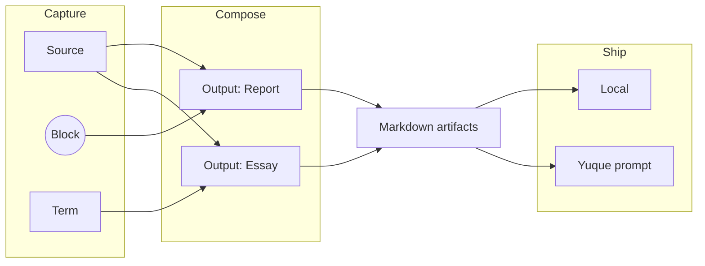

# Writing model

Four ideas shape the product.

## Diffusion

Knowledge should move instead of being copied. A Source, term, or reusable
Block can contribute to several outputs. an output can then flow to several
publishers. The repository preserves those connections and source provenance.

## Document as Code

Writing deserves the same engineering discipline as software:

- Markdown and YAML are the durable interfaces.
- schemas and lint rules make structure explicit.
- deterministic builds turn sources into outputs.
- reconciliation never reorders or drops entries it did not change.
- Git records the history of both content and decisions.

If a code change can be reviewed as a diff, a chapter should be reviewable the
same way. Derived indexes and build products never replace authored files.

## AI Native CLI

An Agent should not need to scrape colorful terminal prose or guess whether a
command succeeded. `mf` exposes stable single-level JSON envelopes, predictable
exit codes, canonical identities, dry-run support, and explicit confirmation
boundaries — a command surface deterministic enough to compose, inspect, retry
and audit.

## Local first

The repository remains useful without a cloud service. Authored content stays
in ordinary files and secrets stay outside committed configuration. External services extend the workflow;
they do not own it.

See the [glossary](../manual/glossary.md) for Mind, Output, Source, Prompt, and Thinking.
