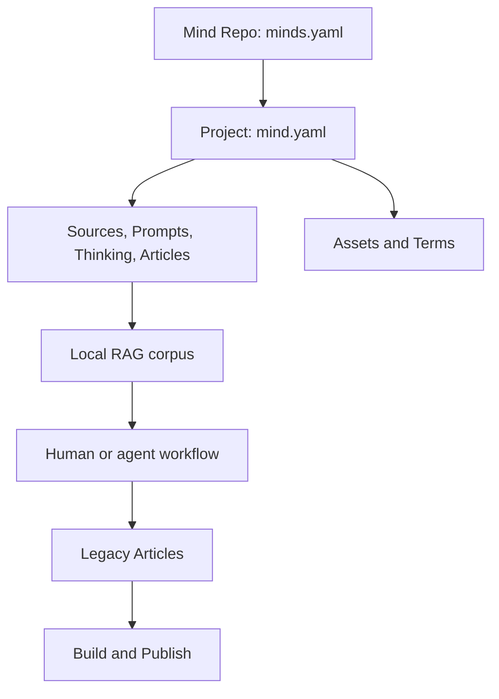

# Work with legacy Articles

Use this guide for projects without `mind.yaml.content_layout`.
These projects keep the Article commands and paths shown below.
For explicit category/bundle projects, use [minds and outputs](minds-and-outputs.md).


```bash
mkdir my-repo && cd my-repo
mf init
mf project new notes
mf article new "First Note" --project notes        # creates docs/first-note/

# Capture evidence; new sources are indexed for search by default
printf '# Reference\n\nA local reference about gateways.\n' > reference.md
mf source new ./reference.md --project notes

# Sync the whole repository into the local RAG corpus, then query it
mf source sync --offline
mf search "gateways" --project notes --output json

# Assemble the article into projects/notes/outputs/first-note.md
mf build first-note --project notes
```

> [!TIP]
> `mf build` takes an article slug (`first-note`) or path (`docs/first-note`),
> and `mf publish run` takes the slug. Neither accepts the title. Run
> `mf article list` to see what is available.
>
> Commands that take an article, prompt, thinking, asset or source also accept
> a path to an existing file or directory, such as
> `mf build projects/notes/docs/first-note`, and pick the project from that
> path. `--project` still wins when given.

There is a longer offline walkthrough in [offline walkthrough](../../quickstart.md).

## Legacy project layout

A Mind Repo holds projects. Each project has four first-class knowledge stores
plus supporting assets and terms:

| Store | Responsibility |
|---|---|
| **Sources** | Evidence and provenance: what the work can rely on. |
| **Prompts** | The control plane: objective, audience, constraints, criteria and durable decisions. |
| **Thinking** | The working ledger: reasoning, conflicts, assumptions, feedback and follow-ups. |
| **Articles** | The current reader-facing synthesis or deliverable. |

Prompts and Thinking are authored Markdown, not throwaway chat context. A
Prompt binds to an Article through its `article` field, and a Thinking ledger
is matched by article key. `mf article show`, `mf prompt list` and
`mf thinking list` show these links.



```text
my-repo/
├── minds.yaml                  # repository config
├── projects/
│   └── notes/
│       ├── mind.yaml           # project config (build, publish, ...)
│       ├── mind-index.yaml     # index projection
│       ├── docs/               # articles
│       ├── sources/            # captured evidence
│       ├── prompts/            # intent and constraints
│       ├── thinking/           # reasoning ledger
│       └── outputs/            # build products
└── .mind-forge/cache/source/advanced/  # rebuildable RAG state
```

`minds.yaml` describes the repository; `mind.yaml` describes a project;
`mind-index.yaml` is the project compatibility/index projection.

## Write in blocks

```bash
mf article new "Design Review" --template arch --project notes
mf article block new design-review risks --project notes
mf article block move design-review risks --after context --project notes
mf article block renumber design-review --project notes
```

| Template | Use |
|---|---|
| `blank` | Default; a single opening block |
| `arch` | Architecture decision: context, decision, consequence, alternatives |
| `prd` | Product requirements |
| `blog` | Blog post |
| `<path>` | Any template file under the project root |

New articles are directories of numbered blocks (`01-opening.md`, ...). Pass
`--file` to create a single-file article instead; `mf article convert
--to-single-file|--to-directory` switches between the two forms.
